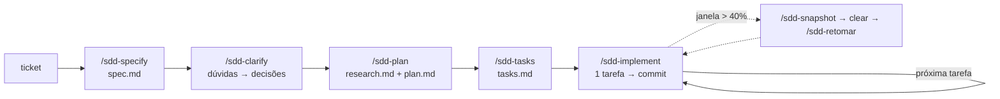

# Lab de Spec-Driven Development · serviço de reembolso

Repositório de prática do workshop **SDD e engenharia de contexto**. Um serviço
Spring Boot pequeno e funcionando, com uma política de negócio nova para implementar
e um bug para corrigir — do jeito que se trabalha com agentes de código em projeto real:
**especificar, esclarecer, planejar, quebrar, implementar uma tarefa por sessão,
verificar e registrar.**

Funciona com **Claude Code** e **GitHub Copilot CLI**. As instruções e skills estão nos
formatos que as duas ferramentas leem; o que muda é só o atalho de cada uma.

> A empresa (Orbe Tecnologia), a política e os tickets são fictícios. O domínio é
> inventado de propósito: o modelo não tem a solução decorada, e a diferença que a spec
> faz fica visível.

## Requisitos

- Java 21 (`java -version`)
- Git
- Claude Code **ou** GitHub Copilot CLI, autenticado
- Maven não é necessário: o projeto traz o Maven Wrapper (`./mvnw` / `mvnw.cmd`),
  que baixa o Maven na primeira execução.

```bash
git clone <url-deste-repo> sdd-lab && cd sdd-lab
./mvnw -q test                 # Windows: mvnw.cmd -q test
java scripts/SddCheck.java     # portão dos artefatos SDD
```

## O fluxo



Cada passo produz um arquivo em disco que um humano revisa. É isso que permite
limpar o contexto a qualquer momento e continuar de onde parou.

## Onde fica cada coisa

```
AGENTS.md                  instruções operacionais (lido por Copilot CLI e outros agentes)
CLAUDE.md                  importa o AGENTS.md + notas específicas do Claude Code
sdd/constitution.md        regras permanentes de engenharia
sdd/templates/             modelos de spec, plan, tasks, progress, bugfix, research
sdd/agentes/               texto-fonte dos sub-agentes
.claude/skills/sdd-*/      skills do fluxo (lidas pelo Claude Code e pelo Copilot CLI)
.claude/agents/            sub-agentes no formato do Claude Code
.github/agents/            os mesmos sub-agentes no formato do Copilot CLI
specs/001-.../             exemplo completo de spec já implementada
tickets/                   pedidos de negócio para os exercícios
docs/                      política de negócio (fonte da verdade do domínio)
labs/                      exercícios guiados
scripts/                   portão (verify), checagem de artefatos (SddCheck)
```

## Atalhos por ferramenta

| O que | Claude Code | Copilot CLI |
|---|---|---|
| Abrir | `claude` | `copilot` |
| Rodar uma skill | `/sdd-specify tickets/TICKET-002-politica-v3.md` | `/sdd-specify tickets/TICKET-002-politica-v3.md` |
| Ver skills | digite `/` | `/skills list` |
| Ver sub-agentes | `/agents` | `/agent` |
| Uso da janela | `/context` | `/context` |
| Compactar | `/compact` | `/compact` |
| Limpar | `/clear` | sair e abrir uma sessão nova |
| Modo plano | `Shift+Tab` | `Shift+Tab` |
| Retomar sessão | `claude --continue` | `copilot --continue` |

> Quando mudar um sub-agente, mude o texto em `sdd/agentes/` e copie para as duas
> pastas (`.claude/agents/` e `.github/agents/`). As duas ferramentas não leem a pasta uma da outra.

## Labs

| # | Lab | Tempo | O que você pratica |
|---|---|---|---|
| 00 | [Preparação](labs/LAB-00-preparacao.md) | 15 min | ambiente, o que o agente carrega sozinho |
| 01 | [Contexto](labs/LAB-01-contexto.md) | 20 min | medir a janela, o diff do AGENTS.md |
| 02 | [Especificar e esclarecer](labs/LAB-02-specify-clarify.md) | 30 min | spec com requisitos e critérios, morte silenciosa |
| 03 | [Planejar](labs/LAB-03-plan.md) | 25 min | research por sub-agente, spec × plano |
| 04 | [Quebrar em tarefas](labs/LAB-04-tasks.md) | 20 min | tarefa do tamanho certo, `[P]`, portão |
| 05 | [Implementar como orquestrador](labs/LAB-05-implement.md) | 40 min | uma tarefa por sessão, implementador e revisor |
| 06 | [Cair e voltar](labs/LAB-06-recuperacao.md) | 20 min | snapshot, clear, retomar, reverter |
| 07 | [Bugfix com spec mínima](labs/LAB-07-bugfix.md) | 20 min | atual / esperado / não pode mudar |
| 08 | [Medir em vez de achar](labs/LAB-08-medir.md) | 30 min | A/B entre plan mode e SDD |
| 09 | [Bônus: loop autônomo](labs/LAB-09-loop.md) | 20 min | loop com limite, quando não usar |

## Gabarito

A branch `gabarito` tem a spec 002 e o bugfix 003 resolvidos de ponta a ponta, com
um commit por tarefa. Use para comparar **depois** de tentar:

```bash
git log --oneline gabarito
git diff main gabarito -- specs/
```

Sua spec não precisa ficar igual. Precisa responder às mesmas perguntas.
