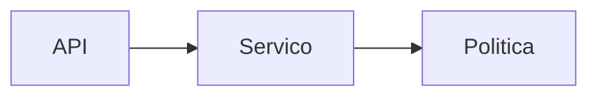

# Plano NNN · <nome da mudança>

> **Como.** Aqui entram classe, tabela, endpoint, biblioteca. Toda decisão com o porquê.
> Spec de referência: `specs/NNN-nome/spec.md`

## Contexto técnico encontrado

<Resumo do research.md: o que existe hoje e onde (arquivo:linha). Só o que importa
para esta mudança.>

## Checagem da constitution

| Artigo | Como este plano cumpre |
|---|---|
| Art. 1 · Camadas | ... |
| Art. 2 · Dinheiro e datas | ... |
| Art. 3 · Políticas como componentes | ... |
| Art. 4 · Erros | ... |
| Art. 5 · Testes | ... |
| Art. 6 · Dependências | ... |

## Desenho

<Componentes novos e alterados. Um diagrama mermaid ajuda a revisar antes de ler tudo.>

## Contrato da API

<Requisição, resposta e erros, com exemplos JSON.>

## Modelo de dados

<Campos novos, migrações, índices, versionamento.>

## Decisões e porquês

| Decisão | Alternativas consideradas | Por quê |
|---|---|---|

## Riscos

<O que pode dar errado e como o plano mitiga.>

## Estratégia de teste

<Qual teste prova qual critério de aceite (CA1 → NomeDoTeste#metodo).>
