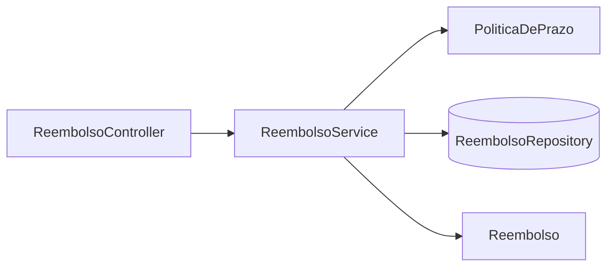

# Plano 001 · Reembolso básico

Spec: `specs/001-reembolso-basico/spec.md`

## Checagem da constitution

| Artigo | Como este plano cumpre |
|---|---|
| Art. 1 · Camadas | `api.ReembolsoController` → `servico.ReembolsoService` → `dominio.Reembolso` |
| Art. 2 · Dinheiro e datas | `BigDecimal(12,2)`; `Clock` injetado em `PoliticaDePrazo` e no serviço |
| Art. 3 · Políticas | prazo isolado em `servico.PoliticaDePrazo` |
| Art. 4 · Erros | `api.TratadorDeErros` mapeia as exceções de domínio para 400/404/409/422 |
| Art. 5 · Testes | `ReembolsoApiTest` (CA1–CA7) e `PoliticaDePrazoTest` |
| Art. 6 · Dependências | só starters do Spring Boot e H2 |

## Desenho

## Contrato da API

| Método | Caminho | Sucesso | Erros |
|---|---|---|---|
| POST | `/reembolsos` | 201 + corpo + `Location` | 400, 409 (duplicado), 422 (prazo, futuro) |
| GET | `/reembolsos/{id}` | 200 | 404 |
| GET | `/reembolsos?colaborador=` | 200, lista | — |
| POST | `/reembolsos/{id}/aprovacao` | 200 | 404, 409 (transição) |
| POST | `/reembolsos/{id}/rejeicao` | 200 | 404, 409 (transição) |

Corpo de decisão: `{"responsavel": "bruno", "motivo": "opcional"}`.

## Decisões e porquês

| Decisão | Alternativas | Por quê |
|---|---|---|
| Transições de status dentro da entidade | validar no serviço | a regra fica junto do estado e não pode ser contornada |
| H2 em memória | Postgres em container | o lab precisa rodar sem Docker |

## Estratégia de teste

CA1–CA7 → `api.ReembolsoApiTest`. R2/R3 em detalhe → `servico.PoliticaDePrazoTest`.
