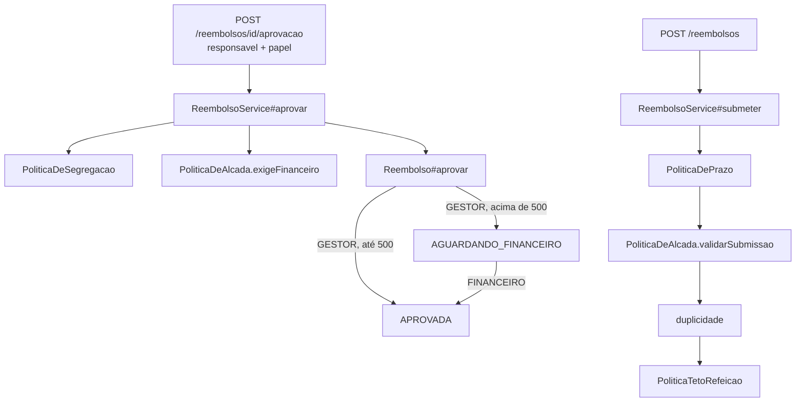

# Plano 002 · Política de Despesas v3

Spec: `specs/002-politica-v3/spec.md` · Research: `specs/002-politica-v3/research.md`

## Contexto técnico encontrado

Transições de status vivem em `Reembolso`; regras de política vivem em componentes de
`servico/` (modelo: `PoliticaDePrazo`). Não há `@Version` nem registro por nível de
aprovação. O contrato de aprovação não carrega o papel.

## Checagem da constitution

| Artigo | Como este plano cumpre |
|---|---|
| Art. 1 · Camadas | papel validado na API (formato), regras nas políticas, transições na entidade |
| Art. 2 · Dinheiro e datas | limites como `BigDecimal` com escala 2; sem datas novas |
| Art. 3 · Políticas | três componentes novos: `PoliticaDeAlcada`, `PoliticaDeSegregacao`, `PoliticaTetoRefeicao` |
| Art. 4 · Erros | 409 para transição e concorrência; 422 para alçada, segregação e teto |
| Art. 5 · Testes | CA1–CA15 mapeados abaixo; testes de API alterados só pelo contrato novo |
| Art. 6 · Dependências | nenhuma nova |

## Desenho



## Contrato da API

Aprovação (muda):

```json
POST /reembolsos/{id}/aprovacao
{"responsavel": "bruno", "papel": "GESTOR"}     // papel: GESTOR | FINANCEIRO, obrigatório
```

Resposta ganha `aprovadorGestor` e `aprovadorFinanceiro`. Rejeição não muda.

| Situação | Código |
|---|---|
| papel ausente | 400 |
| transição inválida (R4) | 409 |
| conflito de concorrência (R7) | 409, título "Conflito de concorrência" |
| alçada, segregação, teto (R3, R5, R6) | 422 |

## Modelo de dados

`reembolso` ganha `aprovador_gestor`, `aprovador_financeiro` e `versao` (`@Version`).
Status ganha `AGUARDANDO_FINANCEIRO`. (No lab o esquema é recriado a cada execução; em
produção seria uma migração.)

## Decisões e porquês

| Decisão | Alternativas | Por quê |
|---|---|---|
| `@Version` (otimista) | lock pessimista; `synchronized` | conflito é raro; otimista não segura conexão e funciona com várias instâncias |
| `saveAndFlush` na aprovação | `save` | o conflito aparece dentro do serviço e é traduzido de forma previsível |
| Estado intermediário `AGUARDANDO_FINANCEIRO` | flag booleana | o estado é visível na listagem e as transições ficam explícitas |
| Ordem na submissão: prazo → alçada → duplicidade → teto | teto antes | duplicado de refeição precisa receber a mensagem de duplicado |
| Manter `aprovar(responsavel, quando)` até a T006 | trocar a assinatura direto | cada commit compila e passa nos testes (expandir, depois contrair) |

## Riscos

- Consumidor da API sem papel quebra: mitigado pela decisão da spec (só o front interno).
- Teste de concorrência instável: as asserções não dependem da ordem das threads, só de "exatamente uma vence".

## Estratégia de teste

| CA | Teste |
|---|---|
| CA1, CA2, CA3 | `AprovacaoPorAlcadaApiTest`, `ReembolsoTransicoesTest` |
| CA4, CA5 | `PoliticaDeAlcadaTest`, `AprovacaoPorAlcadaApiTest` |
| CA6, CA7 | `ReembolsoTransicoesTest`, `AprovacaoPorAlcadaApiTest` |
| CA8, CA9 | `PoliticaDeSegregacaoTest`, `AprovacaoPorAlcadaApiTest` |
| CA10–CA13 | `PoliticaTetoRefeicaoTest` |
| CA14 | `ConcorrenciaAprovacaoTest` |
| CA15 | `ReembolsoTransicoesTest`, `AprovacaoPorAlcadaApiTest` |
