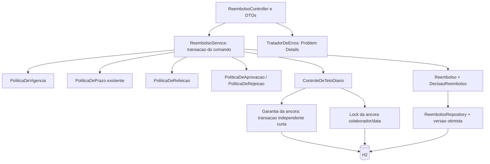

# Plano 002 · Política de Despesas v3

- **Spec de referência:** `specs\002-politica-v3\spec.md`
- **Pesquisa:** `specs\002-politica-v3\research.md`
- **Status:** aprovado
- **Aprovado por:** usuário em 21/10/2026, mediante confirmação explícita para criar as tarefas
- **Escopo deste artefato:** desenho técnico; nenhuma implementação autorizada por este documento isoladamente.

## Contexto técnico encontrado

O serviço atual usa transações Spring e JPA sobre H2 em memória. `ReembolsoService#submeter` valida prazo e duplicidade; `Reembolso#aprovar/rejeitar` decide somente a partir de SUBMETIDA. Uma decisão sobrescreve os campos singulares; não há histórico por etapa ou controle de concorrência (`src\main\java\com\orbe\reembolso\servico\ReembolsoService.java:28-57`; `src\main\java\com\orbe\reembolso\dominio\Reembolso.java:74-96`).

O contrato atual deve continuar funcionando para v2. Os testes fixam 20/10/2026, permitindo preservá-los sem exigir novas declarações. A configuração usa create-drop e desativa open-in-view; os dados novos precisam ser carregados dentro da transação (`src\test\java\com\orbe\reembolso\suporte\RelogioDeTeste.java:13-27`; `src\main\resources\application.yml:1-14`). Evidências completas, incluindo limitações da pesquisa, estão em research.md.

## Checagem da constitution

| Artigo | Como este plano cumpre |
|---|---|
| Art. 1 · Camadas | DTOs e tradução HTTP em api; políticas, repositórios e transações em servico; estados, eventos e invariantes em dominio. Domínio não depende de DTOs ou infraestrutura HTTP |
| Art. 2 · Dinheiro e datas | BigDecimal com escala 2, sem arredondamento de entradas inválidas; Clock injetado e America/Sao_Paulo. Uma captura temporal por comando, reutilizada para vigência, prazo e registro |
| Art. 3 · Políticas como componentes | Reutilizar PoliticaDePrazo; criar PoliticaDeRefeicao, PoliticaDeAprovacao, PoliticaDeRejeicao e PoliticaDeVigencia. O serviço coordena políticas e persistência, sem copiar limites ou permissões |
| Art. 4 · Erros | Problem Details exclusivamente via TratadorDeErros; formato 400, ausência 404, estado/concorrência 409 e regras 422. Tratar explicitamente novos erros de entrada e versão, sem capturar genericamente exceções SQL |
| Art. 5 · Testes | CA1 a CA32 mapeados abaixo; verificar corpo, estado e registros persistidos. Preservar testes v2 e acrescentar contexto v3; qualquer conflito com teste existente interrompe a tarefa e é registrado |
| Art. 6 · Dependências | Nenhuma dependência nova; JPA, transações, H2, validação e infraestrutura de testes já disponíveis |
| Art. 7 · Segurança | Somente identificadores fictícios e nenhuma credencial. Explicitar no contrato que identidade/papel/vínculo são declarações não autenticadas do laboratório; não registrar corpos com dados pessoais |

A divergência do prazo no 60º dia é uma decisão de negócio já aprovada e não uma mudança da constitution. Nenhum artigo será alterado.

## Desenho



### Responsabilidades e transições

- `PoliticaDeVigencia`: classificar pelo `submetidoEm` imutável, com corte em 01/11/2026 às 00:00 Brasília. Não usar data da despesa nem data da decisão para reclassificar pedidos.
- `PoliticaDePrazo`: manter o algoritmo `dias >= 60`; permitir receber a data de referência capturada pelo comando, preservando o uso de Clock e a assinatura existente por delegação se necessário. Não alterar os testes atuais nem corrigir o limite.
- `PoliticaDeRefeicao`: calcular e validar total com BigDecimal contra `120.00`, sem acesso HTTP. Receber o total persistido e o valor proposto; na aprovação, validar o total que já inclui o próprio pedido.
- `PoliticaDeAprovacao`: limites `500.00` e `5000.00`, separação de pessoas e validação das declarações. Compartilhar a verificação de autorização por etapa com `PoliticaDeRejeicao`, sem duplicar regras; extrair um colaborador pequeno apenas se a implementação exigir.
- `PoliticaDeRejeicao`: autorizar somente o responsável declarado pela etapa atual, exigir motivo não branco e pessoas distintas na etapa financeira.
- `Reembolso`: manter os dados e transições; adicionar `AGUARDANDO_FINANCEIRO`. V3 até R$ 500,00: SUBMETIDA → APROVADA por gestor. V3 acima de R$ 500,00: SUBMETIDA → AGUARDANDO_FINANCEIRO → APROVADA. Rejeição autorizada de qualquer etapa pendente → REJEITADA. APROVADA, REJEITADA e PAGA não aceitam decisões.
- V2 mantém SUBMETIDA → APROVADA/REJEITADA, sem exigir papel, vínculo, etapa ou motivo novo. A proteção otimista vale também para ela.
- `DecisaoReembolso`: evento imutável na aplicação para cada decisão v3 aceita, com etapa, resultado, responsável, momento e motivo. Acrescentar evento e atualizar o pedido na mesma transação. Não criar evento de submissão, tentativa recusada ou reconstrução de passado v2.

### Total diário e transações

Reservar não exige um contador duplicado: a reserva é o próprio pedido v3 persistido em estado que consome teto. A consulta soma REFEICAO por colaborador e data da despesa, com `submetidoEm` a partir do corte, excluindo REJEITADA. Considerar SUBMETIDA, AGUARDANDO_FINANCEIRO, APROVADA e PAGA: pagar não desfaz uma aprovação nem libera seu consumo. AGUARDANDO_FINANCEIRO é incluído defensivamente, embora uma refeição válida isolada não alcance essa alçada.

Uma tabela de âncoras por colaborador/data serializa o cálculo e a gravação, inclusive quando não existe pedido naquele dia. A âncora não guarda valor nem representa reserva de negócio.

1. Para operação de refeição v3 que modifica ou valida o total, obter a chave colaborador/data.
2. `ControleDeTetoDiario` garante a existência da âncora em transação curta REQUIRES_NEW, usando TransactionTemplate com o gerenciador existente. Consulta existência, insere se necessário e força flush. Se outra transação criar a mesma chave, deixar a transação interna reverter e tratar somente a colisão identificada da chave primária, fora dela; confirmar a existência da âncora numa nova leitura. Qualquer outra falha é propagada, nunca ignorada.
3. Na transação do comando, adquirir `PESSIMISTIC_WRITE` sobre essa âncora antes de ler o total. A garantia inicial deve ocorrer antes de qualquer lock ou gravação da operação externa, para não bloquear a si própria.
4. Com isolamento READ_COMMITTED explícito nas operações protegidas, somar o estado confirmado após obter o lock; validar e salvar dentro da mesma transação. A segunda operação aguarda a primeira encerrar e então vê seu resultado.
5. Na rejeição, adquirir a mesma âncora antes de mudar o estado; o commit libera o consumo para submissões posteriores. Uma aprovação não soma novamente seu valor.

Para decisões, pode ser necessário ler inicialmente o pedido para descobrir a chave. Depois de adquirir a âncora, reler/atualizar a entidade e revalidar estado, etapa e versão; a leitura inicial não autoriza a decisão. A ordem é sempre âncora antes da modificação do pedido. Falhas provocam rollback; não há retry automático de decisões.

A âncora vazia pode permanecer após uma recusa. Ela é infraestrutura sem valor reservado, não um pedido criado ou uma reserva, e não aparece na API. Não usar mutex local, lock de uma soma ou bloqueio apenas de pedidos existentes: nenhum deles resolve o primeiro pedido por dia em múltiplas instâncias.

### Decisões concorrentes e etapas

Adicionar `@Version` ao pedido e executar flush antes de devolver sucesso. Duas transações que leram a mesma versão não podem confirmar alterações diferentes: uma falha com conflito otimista e reverte também seu evento.

Na v3, exigir a etapa explicitamente declarada na requisição. Uma tentativa de GESTOR não pode virar aprovação financeira depois que outra transação avançar o estado. Verificar a correspondência etapa/estado antes da autorização e novamente sobre qualquer entidade recarregada. Versão otimista não substitui essa checagem.

Uma requisição FINANCEIRO só pode ser aceita quando a leitura transacional válida já encontra AGUARDANDO_FINANCEIRO. Se encontra SUBMETIDA, falha com 409; não espera automaticamente pela aprovação do gestor. Não prometer ordenação pela chegada HTTP: a ordem válida é a das transições efetivamente observadas e confirmadas.

## Contrato da API

### Submissão e consultas

Manter `POST /reembolsos`, `GET /reembolsos/{id}` e `GET /reembolsos?colaborador=...`, nomes atuais e validações. Submissão aceita continua retornando 201 e Location; decisões aceitas continuam retornando 200. Listagem mantém `dataDespesa DESC, id DESC`, sem acrescentar controle de acesso ou paginação nesta entrega.

O instante da submissão vem do servidor, nunca do corpo. Capturá-lo uma vez no início do comando, e derivar dele o dia de referência para prazo e regime. A espera por lock não altera a versão da política atribuída a essa submissão.

### Declaração de decisão

Manter `POST /reembolsos/{id}/aprovacao` e `/rejeicao`. Estender `DecisaoRequest` e introduzir comando de decisão independente da API, com os campos:

| Campo | Semântica |
|---|---|
| responsavel | Identidade declarada de quem decide; manter obrigatório, não branco, máximo 80 e trim |
| papel | GESTOR ou FINANCEIRO; exigido pela regra da v3, ausente permitido na v2 |
| colaboradorVinculado | Colaborador ao qual a declaração de atribuição se refere; na v3 deve coincidir com o solicitante |
| gestorImediato | Identidade declarada do gestor imediato desse colaborador; na etapa GESTOR deve coincidir com responsavel; opcional na etapa financeira |
| etapa | GESTOR ou FINANCEIRO; exigida na v3 e comparada com a etapa pendente; não inferir a partir do papel |
| motivo | Manter máximo 500; na rejeição v3 deve conter texto não branco; aprovação não registra motivo |

O vínculo financeiro é expresso pelo papel FINANCEIRO associado ao `colaboradorVinculado`. Não se consulta cadastro: qualquer declaração válida é tratada como verdadeira, com a limitação de personificação aprovada na spec. Não transformar esse campo em exigência de designação real por pedido ou gestor financeiro específico.

Aplicar trim aos novos identificadores declarados, mantendo comparação sensível a caixa e sem mudar o comportamento do parâmetro de listagem. Mudança do gestor declarado vale para decisões futuras, não reatribui eventos anteriores. Declarações contraditórias são recusadas, não corrigidas automaticamente.

Exemplo de aprovação de gestor v3:

```json
{
  "responsavel": "bruno",
  "papel": "GESTOR",
  "colaboradorVinculado": "ana",
  "gestorImediato": "bruno",
  "etapa": "GESTOR"
}
```

Exemplo de rejeição financeira v3:

```json
{
  "responsavel": "carla",
  "papel": "FINANCEIRO",
  "colaboradorVinculado": "ana",
  "etapa": "FINANCEIRO",
  "motivo": "Despesa sem justificativa de servico"
}
```

Na v2 continua válido `{"responsavel":"bruno"}`. Não colocar `@NotNull` global nos campos novos, nem `@NotBlank` global no motivo: isso impediria decisões legadas aprovadas em R9.

### Resposta e histórico

Preservar todos os campos de `ReembolsoResponse` e acrescentar `politica` (V2/V3), `etapaPendente` (GESTOR/FINANCEIRO/null) e `historico` em ordem de aceitação. A versão otimista é interna e não precisa ser exposta neste contrato.

`decididoPor`, `decididoEm` e `motivoDecisao` continuam representando a última decisão aceita, inclusive após aprovação parcial; o histórico guarda as anteriores. Após aprovação, motivo singular é null; após rejeição, contém o motivo. V2 mantém esses campos e `historico: []`, sem fabricar etapa antiga.

Exemplo parcial dos campos de uma hospedagem v3 de R$ 800,00, após gestor:

```json
{
  "valor": 800.00,
  "status": "AGUARDANDO_FINANCEIRO",
  "politica": "V3",
  "etapaPendente": "FINANCEIRO",
  "decididoPor": "bruno",
  "decididoEm": "2026-11-03T10:00:00",
  "motivoDecisao": null,
  "historico": [
    {
      "etapa": "GESTOR",
      "resultado": "APROVADA",
      "responsavel": "bruno",
      "quando": "2026-11-03T10:00:00",
      "motivo": null
    }
  ]
}
```

Na aprovação final acrescentar o evento FINANCEIRO, sem substituir o primeiro. Momento sem offset preserva o contrato LocalDateTime; todos os valores são documentados como horário de Brasília. Carregar eventos nas consultas por id e listagem por EntityGraph ou consulta equivalente, dentro da transação, sem depender de open-in-view ou serializar entidade diretamente.

### Erros

| Situação | Código e tratamento |
|---|---|
| Formato inválido, enum desconhecido, tamanho excedido, responsavel branco, JSON ilegível | 400 via TratadorDeErros; preservar mapa campos quando aplicável |
| Pedido inexistente | 404, sem criar evento |
| Duplicidade, etapa fora de ordem/repetida, pedido encerrado | 409, preservando pedido e histórico |
| Disputa de versão otimista ou timeout de lock da operação de negócio | 409 com explicação do conflito e sem sucesso parcial; não fazer retry automático da decisão |
| Teto, valor acima de R$ 5.000,00, autorização declarada inválida/ausente na v3, motivo de rejeição v3 vazio | 422 com motivo específico; ausência contextual não deve bloquear o contrato v2 na validação global |
| Prazo/futuro | Manter 422 e mensagens existentes |

Traduzir explicitamente as exceções Spring/JPA concretas usadas pelo mecanismo escolhido. A colisão conhecida na criação da âncora é resolvida internamente apenas quando sua existência for confirmada; não confundir com duplicidade de nota. Não adicionar handler genérico que converta erro inesperado de banco em conflito de negócio.

## Modelo de dados

| Elemento | Alteração |
|---|---|
| reembolso | Acrescentar coluna `versao` para @Version; manter todos os dados, momentos e campos singulares existentes |
| status | Acrescentar AGUARDANDO_FINANCEIRO, mantendo nomes dos estados atuais |
| decisao_reembolso | Nova entidade: id, reembolso_id obrigatório, ordem, etapa, resultado, responsavel (80), quando, motivo (500). Unicidade (reembolso_id, ordem); FK para pedido; consulta ordenada por ordem |
| dia_refeicao | Nova entidade de âncora com chave composta (colaborador de até 80, data_despesa); sem contador monetário |
| regime | Derivar V2/V3 de submetidoEm imutável, sem uma coluna duplicada nem alteração retroativa do dado |
| consulta do teto | Índice por colaborador, data_despesa e categoria; soma BigDecimal dos estados consumidores e do corte de submetidoEm |

O agregado de pedido controla a adição de decisões; não expor operação de alteração/remoção de evento. Configurar persistência em cascata para acréscimo e limpeza dos testes existentes, sem criar operação pública de exclusão de histórico. `ordem` é sequencial dentro do agregado; o controle de versão impede duas confirmações para a mesma posição.

Com H2 create-drop, Hibernate cria os elementos novos. Não adicionar Flyway/Liquibase nem alegar migração de banco durável. Os testes de legado precisam persistir fixtures v2 com timestamp anterior ao corte e decisões singulares, depois operar/consultar após o corte; ausência de eventos deve ser mantida. Uma futura mudança para armazenamento persistente exigirá plano de migração próprio, incluindo versão inicial não nula.

## Decisões e porquês

| Decisão | Alternativas consideradas | Por quê |
|---|---|---|
| Regime calculado de submetidoEm imutável | Coluna de regime; usar data da despesa ou da decisão | O timestamp já existe e corresponde ao corte aprovado; evita duplicação e reenquadramento |
| Estado intermediário e eventos separados | Sobrescrever o trio atual; manter somente colunas para cada aprovador | Explicita a etapa pendente e preserva autoria de cada decisão, inclusive rejeição após gestor |
| Manter campos singulares como última decisão, com novos campos aditivos | Remover campos antigos; mudar sua interpretação para apenas decisão final | Preserva o formato legado e torna a aprovação parcial consultável sem perda de histórico |
| Etapa explícita na decisão v3 e @Version no pedido | Inferir etapa após lock; bloquear pessimisticamente só o pedido; retry de decisão | Evita reinterpretar requisição como outra etapa, impede sobrescrita e devolve conflito ao perdedor sem decisão automática |
| Âncora única por colaborador/data e soma sob lock | Mutex na JVM; lock de linhas de pedidos; contador de saldo; isolamento sem âncora | Protege inclusive dia vazio e múltiplas instâncias; soma evita divergência entre pedido e contador |
| Criação de âncora em transação curta independente | Insert e captura de conflito na transação do pedido; MERGE dependente do banco | Um conflito de unicidade não deixa a transação de negócio inutilizável; evita depender de semântica de upsert não comprovada |
| Declarações novas condicionadas à v3 | Autenticação real; cadastro de gestores; campos obrigatórios para todos | Segue a simulação aprovada e preserva requisições v2, sem prometer segurança não implementada |
| Novos contextos de teste com Clock próprio | Mover relógio global para novembro; alterar testes existentes | Mantém a caracterização anterior e prova a vigência sem enfraquecer expectativas |
| Sem dependências novas | Framework de workflow, ferramenta de migração, segurança | A infraestrutura existente cobre o escopo; essas adições não resolveriam a limitação de identidade aprovada |

Durante a implementação, atualizar `specs\001-reembolso-basico\spec.md` para delimitar seu contrato como v2 e referenciar a 002 para submissões novas, sem apagar decisões anteriores, reescrever tasks concluídas ou alterar progress histórico.

## Riscos

- **Autorização simulada:** personificação permanece possível; documentação e exemplos devem dizê-lo. Não usar esta solução como garantia de autorização em produção.
- **Prazo divergente:** a recusa no 60º dia permanece deliberadamente. Caracterizar o limite para não corrigi-lo por acidente; correção depende de outro trabalho.
- **Primeiro pedido do dia:** a criação concorrente da âncora precisa de teste de integração real com H2, incluindo a colisão antes de existir qualquer pedido. Não aceitar solução testada apenas com R$ 80,00 prévio.
- **Transação independente:** a âncora exige conexão extra; testes não podem deixar todas as conexões ocupadas por transações externas esperando criá-la. Criar a âncora antes de locks/escritas e limitar concorrência dos testes com timeouts.
- **Estado desatualizado e deadlocks:** ordem única de lock (âncora antes de modificar pedido), releitura e versão; testar aprovação/rejeição e liberação de saldo concorrentes. Não reaplicar decisões automaticamente.
- **Falha depois de salvar evento:** flush/commit do pedido e evento devem pertencer à mesma transação; verificar ausência de evento órfão ou decisão duplicada após conflito.
- **DDL apenas do laboratório:** create-drop não preserva dados entre reinícios. Não apresentar os testes de fixtures legadas como migração persistente validada.
- **Clientes:** campos novos são aditivos, mas clientes v3 devem entender AGUARDANDO_FINANCEIRO e enviar a etapa. A autorização contextual deve deixar o corpo antigo válido exclusivamente na v2.

## Estratégia de teste

Nomes abaixo são alvos propostos, não testes já existentes ou resultados executados. Priorizar testes comportamentais em poucos arquivos; usar métodos parametrizados para limites/permissões quando isso não prejudicar a leitura. Os testes de API devem consultar novamente o pedido e verificar ausência/presença de eventos e pedidos persistidos, além da resposta.

| Critério | Teste proposto | Prova principal |
|---|---|---|
| CA1 | `ReembolsoPoliticaV3ApiTest#aceitaRefeicaoNoTeto` | SUBMETIDA, valor integral e consumo de R$ 120,00 |
| CA2 | `ReembolsoPoliticaV3ApiTest#recusaRefeicaoAcimaDoTeto` | Motivo, nenhum pedido novo e nenhum consumo |
| CA3 | `ReembolsoPoliticaV3ApiTest#aprova500SomenteComGestor` | Aprovação final e evento com responsável/momento |
| CA4 | `ReembolsoPoliticaV3ApiTest#aprova500e01EmDuasEtapas` | Estado parcial e final, dois eventos ordenados e momentos distintos |
| CA5 | `ReembolsoPoliticaV3ApiTest#recusaFinanceiroAntesDoGestor` | Conflito e ausência de alteração/evento |
| CA6 | `ReembolsoPoliticaV3ApiTest#aprova5000EmDuasEtapas` | Limite superior aceito com ambas as etapas |
| CA7 | `ReembolsoPoliticaV3ApiTest#recusa5000e01OrientandoViagens` | Orientação concreta e nenhum pedido criado |
| CA8 | `ReembolsoPoliticaV3ApiTest#recusaAutoaprovacao` | Regra violada, pendência e histórico vazio |
| CA9 | `ReembolsoPoliticaV3ApiTest#recusaMesmoAprovadorNoFinanceiro` | Preserva aprovação do gestor e pendência financeira |
| CA10 | `ReembolsoPoliticaV3ApiTest#recusaQuemNaoEOGestorDeclarado` | Declaração com responsável D e gestor B não autoriza aprovação |
| CA11 | `ReembolsoPoliticaV3ApiTest#rejeitaNoFinanceiroPreservandoGestor` | Dois eventos, motivo/momento e nova aprovação recusada |
| CA12 | `ReembolsoPoliticaV3ApiTest#rejeitaNoGestorComMotivo` | Rejeição, autoria e motivo |
| CA13 | `ReembolsoPoliticaV3ApiTest#recusaRejeicaoSemMotivo` | Estado e histórico preservados |
| CA14 | `ReembolsoConcorrenciaTest#aceitaUmaDasAprovacoesDaMesmaEtapa` | Uma confirmação, um conflito e um único evento correspondente |
| CA15 | `ReembolsoConcorrenciaTest#resolveDisputaEntreAprovacaoERejeicao` | Um resultado vencedor coerente com estado, motivo e histórico |
| CA16 | `ReembolsoPoliticaV3ApiTest#somaPendentesEAprovadasSemContarDuasVezes` | Total R$ 120,00 antes/depois de aprovar nova refeição |
| CA17 | `ReembolsoPoliticaV3ApiTest#recusaExcedenteSomadoSemAlterarAnterior` | Total permanece R$ 80,00 e só pedido anterior existe |
| CA18 | `ReembolsoPoliticaV3ApiTest#rejeicaoLiberaTetoSemLiberarDuplicidade` | Nova nota de R$ 120,00 aceita; rejeitado não consome teto e continua na duplicidade |
| CA19 | `ReembolsoPoliticaV3ApiTest#separaTetoPorColaboradorEData` | Totais independentes para B no mesmo dia e A no dia seguinte |
| CA20 | `ReembolsoConcorrenciaTest#serializaRefeicoesComSaldoParcial` | R$ 80,00 + apenas uma submissão de R$ 30,00 = R$ 110,00 |
| CA21 | `ReembolsoPoliticaV3ApiTest#recusaVinculoAusente` | Motivo explícito, sem evento ou substituição |
| CA22 | `ReembolsoPoliticaV3ApiTest#mudancaDeclaradaDeGestorNaoReescreveHistorico` | B preservado como aprovador anterior após declaração de D |
| CA23 | `ReembolsoVigenciaApiTest#aplicaV3NaSubmissaoExatamenteNoCorte` | Despesa anterior com submissão à meia-noite exige duas etapas |
| CA24 | `ReembolsoVigenciaApiTest#aprovaLegadoAcimaDe5000DepoisDoCorte` | V2 aceita corpo antigo e decisão única depois da vigência |
| CA25 | `ReembolsoVigenciaApiTest#refeicaoLegadaNaoConsomeTetoV3` | Reserva v3 de R$ 120,00 independente da refeição v2 de R$ 100,00 |
| CA26 | `ReembolsoVigenciaApiTest#consultaLegadoSemInventarEtapas` | Estado/autoria anteriores intactos e histórico de etapas vazio |
| CA27 | `ReembolsoConcorrenciaTest#protegeDecisaoUnicaLegada` | Um sucesso e um conflito com autoria correta na v2 |
| CA28 | `ReembolsoPoliticaV3ApiTest#financeiroNaoRejeitaAntesDoGestor` | Pedido até R$ 500,00 preservado e sem evento |
| CA29 | `ReembolsoPoliticaV3ApiTest#recusaAutorrejeicao` | Regra explícita, sem alteração |
| CA30 | `ReembolsoPoliticaV3ApiTest#gestorNaoRejeitaTambemNoFinanceiro` | Preserva etapa anterior e pendência financeira |
| CA31 | `ReembolsoPoliticaV3ApiTest#historicoContemSomenteDecisoesAceitas` | Apenas rejeição aceita, sem submissão ou tentativa recusada |
| CA32 | `ReembolsoPoliticaV3ApiTest#recusaMotivoSoComEspacos` | Recusa sem mudança de estado/histórico |

### Provas complementares necessárias ao mecanismo

- `PoliticaDePrazoTest`: acrescentar caracterização da recusa de exatamente 60 dias sem modificar as expectativas de 59, 61 ou futuro.
- `ReembolsoConcorrenciaTest#serializaPrimeirasRefeicoesDoDia`: duas notas distintas de R$ 80,00 no dia vazio; apenas uma aceita e soma final R$ 80,00. Verificar também uma única âncora.
- `ReembolsoConcorrenciaTest#naoReinterpretaEtapaConcorrente`: em pedido de R$ 800,00, duas tentativas declaradas GESTOR; apenas uma decisão do gestor, pedido ainda aguardando Financeiro, nunca aprovado financeiramente pela segunda.
- `ReembolsoConcorrenciaTest#protegeEtapaFinanceira`: após gestor, duas decisões financeiras disputam a mesma versão; um único resultado financeiro e evento anterior preservado.
- Exercitar a corrida de criação da âncora, sua recuperação específica de unicidade e a propagação de falha não relacionada; não simular todo erro de integridade como corrida esperada.
- Exercitar JSON inválido, enum desconhecido e erros de versão/lock retornando Problem Details, além dos 400/404/409/422 já cobertos.
- Caracterizar rejeição v2 sem motivo após a vigência, sem impor as regras da v3 ao legado; preservar listagem e desempate por id.

Os testes concorrentes devem usar transações independentes e sincronização controlada (barreiras/latches com timeout), sem sleeps como garantia de corrida, e aguardar todos os resultados. Não envolver o método de teste inteiro numa única transação nem compartilhar EntityManager entre threads. Verificar o estado final em nova transação e o histórico após o rollback do perdedor. Não depender de qual thread vence; identificar e conferir a decisão efetivamente aceita. Controlar o Clock em contextos separados, sem alterar o relógio global v2 nem introduzir relógio mutável compartilhado entre testes paralelos.

### Comandos previstos para implementação

Executar seletores focados por tarefa e, antes de concluí-la, o gate completo:

```powershell
.\mvnw.cmd -q test "-Dtest=ReembolsoPoliticaV3ApiTest,ReembolsoVigenciaApiTest,ReembolsoConcorrenciaTest,PoliticaDePrazoTest"
powershell -NoProfile -ExecutionPolicy Bypass -File scripts\verify.ps1
```

Não criar tasks.md nem iniciar código antes da revisão e aprovação deste plano. A próxima etapa, após aprovação humana, é `/sdd-tasks`.
